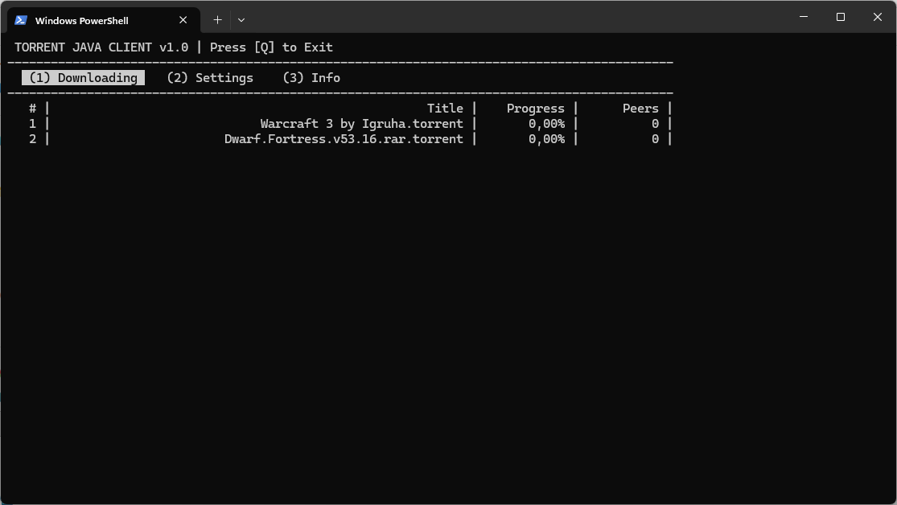

# jTorrTui - `j`ava `Torr`ent `TUI` client v1.0-SNAPSHOT by marolok



## 📝 Описание

Терминальный клиент BitTorrent, написанный на Java с использованием Picocli, JLine и BT-core.

**Основные возможности:**
- 📡 **Авто-обнаружение**: Автоматически сканирует новые `.torrent` файлы каждые 5 секунд
- 👤 **Разработчик**: marolok  
- 🎯 **TUI Интерфейс**: Управление с клавиатуры, вкладки для загрузок, настроек и информации
- 💾 **Постоянные загрузки**: Весь скачанный контент сохраняется в настраиваемой директории

## Quick Start

### Build & Run (Maven)

```bash
# Clean install and build
mvn clean install -U

# Run the app
java -jar target/jTorrTui-1.0-SNAPSHOT-jar-with-dependencies.jar \
  -T "path/to/torrents" -D "path/to/downloads"
```

### Quick Start (Maven Wrapper)

```bash
# Build with wrapper
./mvnw clean install -U

# Run with wrapper
./mvnw compile exec:java -Dexec.mainClass="com.mar.Main" \
  -Dexec.args="-T=C:\Torrents -D=C:\Downloads"
```

### Quick Start (Maven Wrapper on Windows)

```powershell
.\mvnw clean install -U
.\mvnw compile exec:java -Dexec.mainClass="com.mar.Main" ^
  -Dexec.args="-T=C:\Torrents -D=C:\Downloads"
```

## Usage

### Command Line Options

- `-T/--torrens`: Directory containing `.torrent` files (default: `./torrents`)
- `-D/--download`: Output directory for downloaded content (default: `./downloads`)

### Example Commands

```bash
# Use defaults
java -jar target/jTorrTui-1.0-SNAPSHOT-jar-with-dependencies.jar

# Specify directories
java -jar target/jTorrTui-1.0-SNAPSHOT-jar-with-dependencies.jar \
  -T "C:\Torrents" -D "C:\Downloads"

```

### Keyboard Shortcuts

- `↑` / `↓` - Navigate tabs
- `1`, `2`, `3` - Quick tab switch (corresponding to tab numbers)
- `Q` - Quit the application

## How It Works

1. Add a `.torrent` file to the `/torrent` directory
2. The application detects the file and starts downloading automatically
3. Downloaded files are saved to the `/downloads` directory

## Dependencies

- **Picocli**: CLI framework and app lifecycle
- **JLine Terminal/JNA**: Terminal emulation
- **BT-core**: BitTorrent protocol implementation
- **Lombok**: Annotations for reduced boilerplate
- **Logback**: Logging
- **Apache Commons IO**: File utilities

## License

MIT License - feel free to use and modify.
